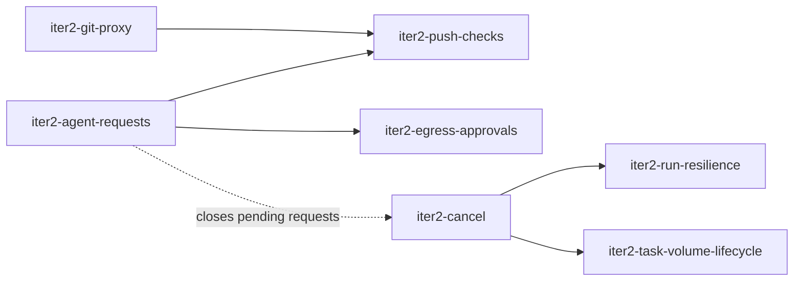

# Iteration 2 — Closed Git Boundary and Human in the Loop

> Scope and plan for the second iteration, agreed on 2026-10-21 ([`roadmap.md`](roadmap.md)). Architecture and decisions: [`product/context.md`](../context.md); run details: [`design/agent-run.md`](../../design/agent-run.md) §11; egress: [`design/egress.md`](../../design/egress.md); requests and approvals: ADR-0038.

## 1. Goal

Remove the last forge credential from sandboxes and let humans make the decisions an agent needs during a run:

- Every Git operation of a sandbox goes through the gateway's Git smart-HTTP proxy. The proxy holds the forge credential, allows pushes only to the task's own refs, and checks every pushed commit (secrets, identity, protected paths, size, history shape).
- Agents ask questions and request approvals through factory tools. Humans answer from one inbox, on a phone or a desktop, and the control plane applies approved actions itself.
- Denied egress hosts can be allowed from the live log or through an approval, without restarting the run.
- Humans can stop a run or cancel a task.
- Tasks recover from rate limits, lost sandboxes and control plane restarts without a human, so batches run through the night. Task volumes are reclaimed and can be reset.

Prerequisites: iteration 1 and iteration 1.1 are done ([`roadmap.md`](roadmap.md)).

## 2. Demo scenario (definition of done)

1. A board member creates task `DF-7`. The sandbox has no forge token and no egress entry for the forge. The runtime clones `https://<gateway>/git/DF-7.git` through the Git proxy.
2. The agent commits a file containing an API key. The runtime's push is rejected (`remote rejected (df:secret-scan …)`). The board member sees a `push-check-exception` request with the masked finding. The agent receives the rejection as a message, removes the key and rewrites its unpushed commits. The next push passes, and the request is closed as obsolete.
3. The agent edits `.forgejo/workflows/ci.yml` (protected path, mode `approval`). The push is rejected, and a `push-check-exception` request appears in the inbox. The agent asks a blocking question ("The CI change needs approval; continue with it?") and ends its turn. On a phone, the board member takes two separate actions: they answer the question, and they approve the `push-check-exception` request. Both decisions arrive as messages, and only then does the next push pass.
4. The agent needs `pypi.org`. The proxy denies it, and a `network-access` request appears with the denied host. The board member approves it for the task. The agent's retry succeeds about a second later, without a restart.
5. The board member stops the running run (the task becomes `waiting`), then cancels another task (status `cancelled`). Its pending requests are closed.

Automated with the fake ACP agent (`iter1-demo-e2e` is extended). Steps 2–4 are also run once manually with Claude Code.

## 3. Changes

| Change | Scope |
|---|---|
| `iter2-git-proxy` | Gateway Git smart-HTTP endpoint: identity by pod IP, forge credential injection, ref enforcement, bare mirror per repository, push audit records. The runtime uses the proxy URL and drops the credential helper. |
| `iter2-agent-requests` | ADR-0038 request model: `ask_question` and `request_approval` factory tools, request storage, inbox and transcript cards, decisions delivered as messages, `AwaitingInput` keep-alive, `blocked` task status. |
| `iter2-push-checks` | Quarantine and checks for pushes: secret scan, commit identity, protected paths, size limits, linear history. Per-project push policy, approval-gated checks raising `push-check-exception`, rejection feedback to the agent. |
| `iter2-egress-approvals` | Task-scoped allowlist entries, "allow" action in the egress log, `network-access` approvals (raised automatically on denials or by the agent). |
| `iter2-cancel` | Stop a run, cancel a task (new `cancelled` status), with UI actions. |
| `iter2-run-resilience` | Resume times for tasks: automatic resume after rate limits (at the retry time) and, bounded, after `sandbox_lost`, `connect_timeout` and `provisioning_failed`; concurrency limit; capacity rejections wait; re-provisioning of interrupted runs (TD-18); final report flush window of 10 minutes (TD-2). |
| `iter2-task-volume-lifecycle` | Deleting task volumes: retention after close and idle TTL, "reset workspace" action. |

Suggested order: `iter2-git-proxy` and `iter2-agent-requests` in parallel, then `iter2-push-checks` and `iter2-egress-approvals`. `iter2-cancel` is independent; its "close pending requests" step lands after `iter2-agent-requests`. `iter2-run-resilience` and `iter2-task-volume-lifecycle` are archived after `iter2-cancel` (they build on `cancelled` and the run-end mapping) and can be implemented any time; `iter2-run-resilience` first, it has the larger effect on unattended use.

## 4. Decisions taken for this iteration

| # | Decision | Alternatives |
|---|---|---|
| 1 | The proxy identifies the sandbox by source pod IP (like the egress proxy). The URL path must name the run's task. | mTLS client certificate: the harness can read the key anyway, so it adds no real protection. |
| 2 | No "direct to forge" fallback: the credential helper is removed, and `CredentialRequest` is always denied (the message stays in the contract, deprecated). | Per-project switch between proxy and v1 helper: two paths to maintain and test. |
| 3 | Pushes are rejected when no push record can be written (the gateway can't reach the control plane). | Accepting unaudited pushes. |
| 4 | Secret-scan findings are approval-gated per finding (fingerprint = rule + blob + line), so false positives can pass. Identity and ref rules are always hard rejects. | Secret findings always rejected: false positives would block the task with no way out. |
| 5 | WIP snapshot pushes get only the secret scan and size limits, and never raise approval requests. | Same checks as the task branch: protected paths and identity make no sense for a snapshot. |
| 6 | Task-scoped allowlist entries are pulled forward from iteration 4, because "allow for this task" is the least-privilege approval scope. Persona scope stays in iteration 4. | Instance and project scope only. |
| 7 | Requests and decisions are stored in their own table and rendered on the task timeline next to the transcript. Decisions reach the agent as system-authored messages. No new transcript event kinds. | Control-plane-authored transcript events: the transcript is runtime-sequenced per run today. |
| 8 | Questions in iteration 2 are addressed to humans only. Questions to a parent task's agent come with the task tree (iteration 3). | — |
| 9 | Only `board-member` decides requests (`approval:decide` maps to it). The full permission model stays in iteration 4. | — |
| 10 | A cancelled task can be reopened by queueing a message (like `failed`). | Terminal `cancelled`: needs an extra "reopen" action. |
| 11 | Tasks resume automatically after rate limits and, up to `runs.maxAutoResumes` consecutive times, after infrastructure failures (`sandbox_lost`, `connect_timeout`, `provisioning_failed`). `failed` runs (harness crash) stay for a human. | Resume everything: a crash loop spends subscription usage all night. Resume nothing: every blip stops the batch. |
| 12 | `runs.maxConcurrent` (default 4) caps active runs per instance; quota rejections re-queue the task without counting as a resume. | Fail the task on a quota rejection (today). |
| 13 | The runtime keeps flushing its final report for up to 10 minutes after finalize (TD-2). A pod that exits without a report ends `sandbox_lost` and is resumed. | Control plane reconstructs the outcome from the outbox on the volume at the next run: more code, same result. |
| 14 | Task volumes are deleted 7 days after `completed`/`cancelled` and after 30 days idle; "reset workspace" deletes on demand. | Keep volumes forever (today): storage grows per task. |
| 15 | Gateway pods report not ready until their first policy snapshot; the runtime retries transient Git failures. | Accept failed clones during gateway rollouts. |

## 5. Contract changes (all additive)

| Contract | Change |
|---|---|
| `darkfactory.gateway.v1` | Snapshot: Git route per sandbox (upstream URL, task/WIP/base branch, commit identity), forge credentials keyed by reference, push policy per project, approved exceptions per task, task-scoped host rules. New services on the control plane: `GatewayGit.RecordPush` (with findings), `GatewayEvents.ReportDenial`. |
| `darkfactory.agent.v1` | `Assign.keep_alive` (AwaitingInput window); `ToolCallResult.await_input_after_turn`; `PushStatus` `REJECTED_BY_CHECK`; `CredentialRequest` marked deprecated. |
| Factory tools | v2 file adds `ask_question` and `request_approval` (type `network-access` in this iteration). |

## 6. Out of scope (later iterations)

- `push-check` WASI plugins, commit signature verification (F7), Git LFS through the proxy.
- Branch rewrite policies (ADR-0033): the proxy allows fast-forward updates of the task branch only.
- Approval types `tool-access`, `repository-mcp-server`, `harness-permission`, `instance-operation`, `project-config` (iteration 4).
- Agents deciding approvals, persona-scoped allowlist entries, PWA push notifications (iteration 5).
- Persisting per-run egress aggregates.

## 7. Verify first (spikes)

- gitoxide: resolving a thin receive-pack against a bare mirror, tree diffs and blob reads with the crates the proxy needs (`iter2-git-proxy`, `iter2-push-checks`).
- Kingfisher: usable as a library crate with its rule set; otherwise use its rule files with our own matcher (`iter2-push-checks`).
- Forgejo smart HTTP with a bot token through a reverse proxy: protocol v2, `filter=blob:none`, `report-status` side-band messages shown by `git push`.
- Claude Code: rendering of a rejected push (`remote rejected`) and whether the harness retries pushes by itself.
