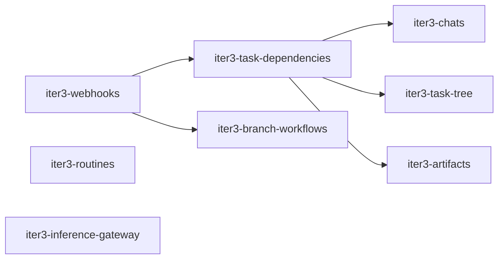

# Iteration 3 — Team Workflow

> **Draft (2026-10-23), not agreed yet.** Scope and plan for the third iteration ([`roadmap.md`](roadmap.md)). Architecture and decisions: [`product/context.md`](../context.md); runs and workspaces: [`design/agent-run.md`](../../design/agent-run.md); agent patterns: [`product/agent-playbook.md`](../agent-playbook.md). OpenSpec changes are created when the iteration starts.

## 1. Goal

Let agents work as a team on a project, with forge events driving the work instead of humans relaying them:

- Forge events (submitted reviews, CI results, merged PRs, mentions) reach the right task without a human (ADR-0015).
- Agents create tasks for other personas (delegation) and tasks depend on other tasks: on their completion or on their PR being merged (ADR-0026, ADR-0033, ADR-0043).
- Tasks form a tree. Subtasks can branch off their parent's branch, and a reviewing task can be based on the branch it reviews (ADR-0034, ADR-0041). The parent is also where questions escalate to: task → parent → chat → human (ADR-0043).
- Results travel between tasks as Markdown artifacts; research on the repository needs no commit (ADR-0044).
- Agents rebase task branches with lease and work on existing branches (ADR-0025, ADR-0033).
- A long-lived chat with a persona per project, itself a task of kind `chat`, creates and coordinates this work; a project context document is injected into every run (ADR-0026, ADR-0043).
- Routines start tasks on a schedule.
- Model credentials leave the sandbox: an inference endpoint in the gateway injects them for Anthropic (subscription token or API key) and OpenAI-compatible providers and measures usage per request (ADR-0010 accepted risk, ADR-0029, F5).

Prerequisites: iteration 2 is done ([`iteration-2.md`](iteration-2.md)).

## 2. Demo scenario (definition of done)

1. In the CEO chat of a project, the board member asks for a change. The CEO creates `DF-20` (implementation, agent A) and `DF-21` (review, agent B) with `blocked_by: DF-20` and `base_task: DF-20` (pattern 2.2).
2. A commits and calls `complete_task`. `DF-21` starts automatically; its HEAD contains A's changes. B builds, runs the tests and submits a review with line comments in the forge.
3. The submitted review wakes `DF-20` through the webhook (individual review comments don't). A addresses the comments and completes again. `DF-21` runs again and sees the new commits without fetching anything. B approves and completes; the PR of `DF-20` is marked ready.
4. A feature task `DF-30` with `subtask_base: parent-branch` and `subtask_merge: parent-agent` gets two iteration subtasks, the second blocked by "PR merged" of the first. The feature agent merges the first subtask PR into the feature branch; the second subtask starts and finds the merge on its base.
5. During `DF-20`, A asks a question the CEO can't decide. The CEO asks the board member in the chat and relays the answer to A. A delegates a research task `DF-22` to a researcher persona and ends its turn. The researcher writes its findings as an artifact; A wakes when `DF-22` completes and reads the artifact.
6. A routine creates a nightly task. A CI failure on its PR wakes it.
7. The sandboxes of all runs hold no model credential, and the gateway reports the token usage of every model request.

Automated with the fake ACP agent and a fake forge webhook sender (`iter1-demo-e2e` is extended). Steps 1–3 are also run once manually with Claude Code against Forgejo.

## 3. Changes

| Change | Scope |
|---|---|
| `iter3-webhooks` | ADR-0015: webhook endpoint in the control plane, `handle-webhook` in the Forgejo plugin with host-side signature verification, filtering (own bot, submitted reviews only), debouncing per task, routing by branch → task mapping and issue mentions, queued notification messages. Follow-ups deferred until webhooks exist: a merged PR completes its task (`iter1-keep-alive-and-review`) and deletes its task volume (`iter2-task-volume-lifecycle`); a ready PR goes back to draft when an `in_review` task gets a new message. |
| `iter3-task-dependencies` | ADR-0043, ADR-0026, ADR-0033: `created_by` becomes a principal (human or task), `create_task` and `list_personas` factory tools, persona `description`; `blocked_by` relations on task completion and on "PR merged"; dependent tasks start automatically; a PR closed without merge queues a message instead of unblocking; a parent is woken by every child that ends (completed, failed, cancelled; ADR-0016). |
| `iter3-task-tree` | ADR-0034, ADR-0041: `parent_id`, `subtask_base` / `subtask_merge` resolution, `base_task`, draft PRs against the base branch, prepare fast-forward for task branches without own commits, notices on parent-branch changes, factory tools to create subtasks and merge subtask PRs, cancelling a task cancels its subtree (`iter2-cancel` non-goal), questions to the parent task's agent (`agent_requests` addressee, `answer_question`; iteration-2 decision 8, ADR-0043), limits on depth and children. UI: Overview and Sub-tasks tabs in the details column, done/total chip on task rows (see [`roadmap.md`](roadmap.md)). |
| `iter3-branch-workflows` | ADR-0033, ADR-0025: branch rewrite policy per project (`never` / `with-lease` / `always`) in the runtime and the Git proxy, tasks starting from existing branches, PR modes `none` and `attach`, forge capabilities to list open PRs and read CI status and job logs. |
| `iter3-artifacts` | ADR-0044: artifact storage per task (chats included), `write_artifact`, `list_artifacts`, `read_artifact` with the ancestor/descendant/`blocked_by`/`base_task` rule, audit of cross-task reads, child-ended message lists artifact names, rendered view in the task page and chat UI. |
| `iter3-chats` | ADR-0043, ADR-0026: a chat is a task of kind `chat`, one per (persona, project), without task branch and PR, exempt from completion and cancel coupling to its children; read-only checkout of the default branch, key suffix `-CHAT`, a chat UI separate from the task UI, summary-based compaction, project context document injected into every run, `project:context:write`. |
| `iter3-routines` | Scheduled tasks with a fixed prompt and persona (`croner`, ADR-0003). |
| `iter3-inference-gateway` | Inference endpoint in the gateway ([`design/egress.md`](../../design/egress.md) §9, F5): pod-IP identity, credential swap and streaming like the Git proxy. Two provider kinds: `anthropic` (Messages API pass-through, subscription token or API key) and `openai-compatible` (base URL, API key, extra headers). Provider configuration (kind, upstream URL, credential reference, allowed models) is instance-wide and referenced by personas; the harness gets the gateway as its base URL and a placeholder credential. The gateway measures usage per request and reports it (`USAGE_SOURCE_GATEWAY`, ADR-0021). The Claude Code host leaves the default allowlist. Depends on the `ANTHROPIC_BASE_URL` result of the iteration-1 Claude spike. |

Suggested order: `iter3-webhooks` first, since review routing and "PR merged" dependencies need it. Then `iter3-task-dependencies` (agents creating tasks is the core primitive), then `iter3-chats` (the entry point and root of the delegation chain) and `iter3-task-tree`: pattern 2.2 only runs on its own once dependencies and `base_task` exist. `iter3-branch-workflows` follows `iter3-webhooks` (CI status, merge triggers). `iter3-artifacts` follows `iter3-task-dependencies` and is independent of the tree and the chats (a chat just uses it). `iter3-routines` and `iter3-inference-gateway` are independent and can run in parallel.

## 4. Decisions taken for this iteration

| # | Decision | Alternatives |
|---|---|---|
| 1 | ADR-0041 (`base_task`, prepare fast-forward) is part of `iter3-task-tree`, not a change of its own: both decide `Workspace.base_branch` at creation and change the PR target. | Separate change: two changes editing the same specs (`workspace-lifecycle`, `pull-request-lifecycle`). |
| 2 | "PR merged" dependencies are part of `iter3-task-dependencies`, not `iter3-branch-workflows`. | Bundle with branch rewrites (ADR-0033): splits the dependency model across two changes. |
| 3 | A chat is a task of kind `chat` (ADR-0043) with key `DF-12-CHAT`, a read-only checkout of the default branch and its own chat UI; it is not shown in the task list. | Separate chat entity: its own message queue, wake-ups and escalation target. |
| 4 | No group tasks; every task has a persona (ADR-0043, ADR-0034 amended). | Persona-less group tasks: nullable persona, auto-completion, branch creation without a run. |
| 5 | A parent wakes on every child that ends, not only on the last one; it decides whether anything is left to do (ADR-0043). | Wake when all children are done: needs a wait-set model. |
| 6 | Personas are global to the instance; no `reports_to` org tree (ADR-0043). | Per-project rosters, static org chart: both can be added later without a breaking change. |
| 7 | Agents write artifacts only on their own task (chats included) and read those of ancestors, descendants, `blocked_by` and `base_task` tasks (ADR-0044). | Read access to the whole project: any task could pull in unrelated or injected content. |
| 8 | One inference endpoint with the provider kinds `anthropic` and `openai-compatible`, instead of an Anthropic-only pass-through. Further ACP harnesses, `df-native` and the factory minion use the same provider configuration, and usage is measured in one place regardless of the harness. | Anthropic-only pass-through: a second credential path per provider and harness, and usage only from the harness. |

To decide before the iteration starts: debounce window (ADR-0015 says 30–60 s), default limits on tree depth and children, whether a dependent task restarts on every re-completion of its dependency or only once per new commit.

## 5. Contract changes (all additive, expected)

| Contract | Change |
|---|---|
| `darkfactory.agent.v1` | Branch rewrite policy in `Assign` for pushes with lease (ADR-0033). Base branches need no change; they reach the runtime as `Workspace.base_branch` (ADR-0034, ADR-0041). `HarnessCredentials` carries the gateway base URL and a placeholder instead of the provider token. |
| `darkfactory.gateway.v1` | Branch rewrite policy in `GitRoute`; inference route per sandbox (provider kind, upstream URL, credential reference, allowed models), provider credentials in the snapshot, usage reports per request. || Integrations WIT | `handle-webhook`, `pull-requests.merge`, branch creation, list open PRs with filters, CI status and job logs (ADR-0028, ADR-0033). |
| Factory tools | Creating tasks (any persona) with `blocked_by` and `base_task`, creating subtasks, `list_personas`, `ask_question` addressed to the parent and `answer_question`, `write_artifact` / `list_artifacts` / `read_artifact`, merging subtask PRs, updating the project context. |
| Database | `tasks.created_by` and `agent_requests.decided_by` become principals; `tasks.kind`; `task_artifacts`; `personas.description`; `agent_requests` gets an addressee (additive on top of iteration 2). |

## 6. Out of scope (later iterations)

- Plugin-based context compaction for chats (F3).
- Cost budgets per subtree (ADR-0034).
- Agents deciding approvals (iteration 6).
- A read-only task mode that rejects a reviewer's pushes (ADR-0041); added only if reviewers commit in practice.
- Heartbeats (ADR-0016).
- Org chart between personas (`reports_to`, delegation allowlists), per-project persona rosters (ADR-0043).
- Direct messaging between sibling tasks; implementer and reviewer talk through the forge (ADR-0036).
- Agents answering approval requests (ADR-0038).
- Provider adapters as WASI plugins (F5), token or cost budgets enforced by the gateway, and the factory minion as a client of the inference configuration (backlog).

## 7. Verify first (spikes)

- Forgejo webhooks: which events distinguish a submitted review from individual review comments; signature header and payload shape (`product/context.md`, open questions).
- Forgejo API: merging a PR with the project's merge method, creating a branch from a ref, the draft/WIP mechanism (ADR-0025).
- Claude Code with `ANTHROPIC_BASE_URL` pointing at the gateway: streaming, token usage reporting, and whether a subscription token works as the swapped bearer.
- Usage fields in streamed responses of the `anthropic` and `openai-compatible` kinds (`stream_options.include_usage` is not supported by every provider).
- [octolib](https://github.com/muvon/octolib) as the provider layer of `iter3-inference-gateway`: pass-through without re-encoding, usage extraction from streams, dependency weight ([`design/egress.md`](../../design/egress.md) §9).
