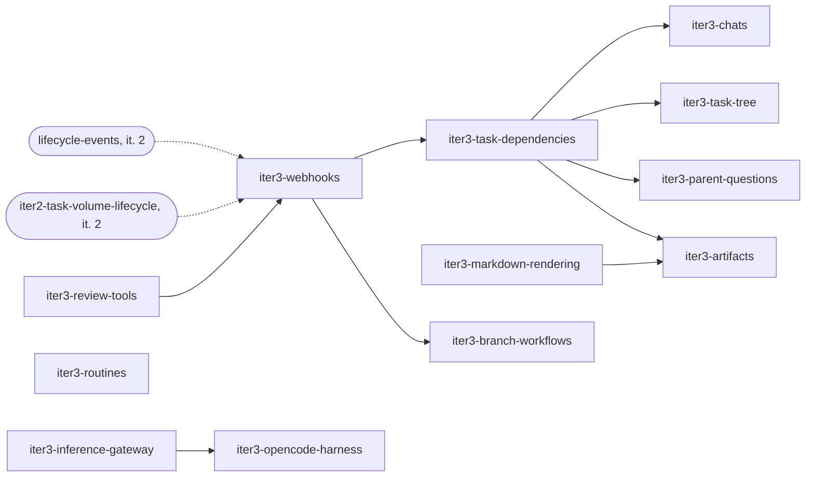

# Iteration 3 — Team Workflow

> **Draft (2026-10-23), not agreed yet.** Scope and plan for the third iteration ([`roadmap.md`](roadmap.md)). Architecture and decisions: [`product/context.md`](../context.md); runs and workspaces: [`design/agent-run.md`](../../design/agent-run.md); agent patterns: [`product/agent-playbook.md`](../agent-playbook.md). OpenSpec changes are created when the iteration starts.

## 1. Goal

Let agents work as a team on a project, with forge events driving the work instead of humans relaying them:

- Forge events (submitted reviews, CI results, merged PRs, mentions) reach the right task without a human (ADR-0015, ADR-0051). Agents read and answer PR feedback through forge tools (ADR-0036).
- Agents create tasks for other personas (delegation) and tasks depend on other tasks: on their Completion or on their being Done (PR merged) (ADR-0026, ADR-0033, ADR-0043, ADR-0052).
- Tasks form a tree. Subtasks can branch off their parent's branch, and a reviewing task can be based on the branch it reviews (ADR-0034, ADR-0041). The parent is also where questions escalate to: task → parent → chat → human (ADR-0043).
- Results travel between tasks as artifacts (Markdown or images such as screenshots); research on the repository needs no commit (ADR-0044, ADR-0048). Markdown renders with highlighted code and Mermaid diagrams (ADR-0047).
- Agents rebase task branches with lease and work on existing branches (ADR-0025, ADR-0033).
- A long-lived chat with a persona per project, itself a task of kind `chat`, creates and coordinates this work; a project context document is injected into every run (ADR-0026, ADR-0043).
- Routines start tasks on a schedule.
- Model credentials leave the sandbox: every persona uses a model provider, an inference endpoint in the gateway injects its credential for the Anthropic Messages, OpenAI Chat Completions and OpenAI Responses APIs, and the gateway is the only source of usage (ADR-0010 accepted risk, ADR-0029, ADR-0050).
- OpenCode runs as a second harness next to Claude Code.

Prerequisites: iteration 2 is done ([`iteration-2.md`](iteration-2.md)); `iter3-webhooks` builds directly on `lifecycle-events` (outbox) and `iter2-task-volume-lifecycle` (retention scan).

## 2. Demo scenario (definition of done)

1. In the CEO chat of a project, the board member asks for a change. The CEO creates `DF-20` (implementation, agent A) and `DF-21` (review, agent B) with `depends_on: DF-20 (completion)` and `base_task: DF-20` (pattern 2.2).
2. A commits and calls `complete_task`. `DF-21` starts automatically; its HEAD contains A's changes. B builds, runs the tests and submits a review with line comments in the forge.
3. `DF-21` ending wakes the CEO, its parent, which messages `DF-20` (ADR-0052; the bot's own reviews never wake a task through webhooks, ADR-0051). A addresses the comments and completes again. The CEO wakes and messages `DF-21`, which runs again and sees the new commits without fetching anything. B approves and completes; the PR of `DF-20` is marked ready.
4. In a project with `subtask_merge: parent-agent`, a feature task `DF-30` creates two iteration subtasks with `base_task: DF-30`, the second depending on the first being Done (`done`, PR merged). The feature agent merges the first subtask PR into the feature branch (`merge_subtask_pr`); the second subtask starts and finds the merge on its base.
5. During `DF-20`, A asks a question the CEO can't decide. The CEO asks the board member in the chat and relays the answer to A. A delegates a research task `DF-22` to a researcher persona and ends its turn. The researcher writes its findings as an artifact; A wakes when `DF-22` completes and reads the artifact.
6. A routine creates a nightly task. A CI failure on its PR wakes it.
7. The sandboxes of all runs hold no model credential, and the gateway reports the token usage of every model request; the runtime reports none.

Automated with the fake ACP agent and a fake forge webhook sender (`iter1-demo-e2e` is extended). Steps 1–3 are also run once manually with Claude Code against Forgejo.

## 3. Changes

| Change | Scope |
|---|---|
| `iter3-review-tools` | ADR-0036, ADR-0015: factory tools `read_pull_request_feedback` (PR comments, reviews, review threads, author roles `bot` / `member` / `outside`) and `comment_on_pull_request` on the task's own PR; WIT `pull-requests.list-feedback` and `reply` in the Forgejo and GitHub plugins. |
| `iter3-webhooks` | ADR-0015, ADR-0051: webhook endpoint per plugin, `handle-webhook` in the Forgejo and GitHub plugins with host-side signature verification, filtering (own bot, submitted reviews only, project setting `webhook_wake`), 30 s debouncing per task through the outbox, routing by branch → task mapping, PR number and issue links, queued notification messages. Humans' reviews wake a task this way; a mention on an issue without a task creating a new task stays in the backlog. Follow-ups deferred until webhooks exist: a merged PR completes its task (`iter1-keep-alive-and-review`) and deletes its task volume (`iter2-task-volume-lifecycle`); a ready PR goes back to draft when an `in_review` task gets a new message. |
| `iter3-task-dependencies` | ADR-0043, ADR-0026, ADR-0033, ADR-0052: `created_by` and queued-message authors become principals (human or task); `parent_id`, set to the creating task when an agent creates a task; factory tools `create_task` (`persona`, `title`, `prompt`, `depends_on: [{task, kind}]`), `list_personas` (name, `description`) and `send_message` (own children only, same rules as a board member's message); optional persona `description`; `depends_on` with kinds `completion` (any past Completion) and `done` (PR merged or marked done), set at creation, same project, all must be satisfied; status `awaiting_dependencies` ("Waiting" group, no branch, volume or sandbox before the first start); dependencies gate only the first start, later rounds are relayed by the parent; a parent is woken by every child that ends (Completion, Done, failed, cancelled) with a system-principal message (key, title, how it ended, summary or reason, PR link, tasks awaiting it), not when the parent is final. Task page shows creator, parent and, while `awaiting_dependencies`, each dependency with kind and state. Task-scoped egress allow rules are not inherited by created tasks. No `depends_on` in the UI form, no "start now" override, no cap on created tasks or relayed messages until `iter3-task-tree`. |
| `iter3-task-tree` | ADR-0034, ADR-0041: `base_task` on `create_task` (no `subtask_base`; a subtask on its parent's branch has the parent as `base_task`), base branch created through the forge at first start, draft PRs against the base branch, prepare fast-forward for task branches without own commits, project setting `subtask_merge` (`human` / `parent-agent`) and factory tool `merge_subtask_pr` (caller is parent and owns the PR's base; subtask marked Done on merge), completion blocked by open subtasks (working, or an unmerged PR into the task's branch), cancelling a task cancels its subtree (`iter2-cancel` non-goal), instance limits on depth (5) and open subtasks per parent (10). UI: Overview and Subtasks tabs in the details column (direct subtasks), done/total chip on task rows (done: `in_review` or Done; total without cancelled); the task list stays flat. Not included: notices on base-branch changes, a parent picker and moving tasks in the UI. |
| `iter3-parent-questions` | ADR-0043, ADR-0038: questions to the parent task's agent (`agent_requests` addressee, `answer_question`; iteration-2 decision 8), falling back to a human when the parent has ended. |
| `iter3-branch-workflows` | ADR-0033, ADR-0025: branch rewrite policy per project (`never` / `with-lease` / `always`) in the runtime and the Git proxy, tasks starting from existing branches, PR modes `none` and `attach`, forge capabilities to list open PRs and read CI status and job logs. |
| `iter3-markdown-rendering` | ADR-0047: shared Markdown renderer (moved out of `transcript/`), syntect code highlighting in CSS-class mode with a 64 KiB plain fallback, `web.codeTheme.light` / `web.codeTheme.dark` in the instance config and Helm values, generated theme stylesheet, vendored Mermaid loaded on demand with `securityLevel: 'sandbox'`. |
| `iter3-artifacts` | ADR-0044, ADR-0048: artifact storage per task (chats included), text and images (PNG, JPEG, WebP, GIF) sniffed in the runtime and again in the control plane, `write_artifact` with `content` or `path`, `list_artifacts`, `read_artifact` with the ancestor/descendant/`depends_on`/`base_task` rule, audit of cross-task reads, child-ended message lists artifact names, rendered view in the task page and chat UI, image endpoint, inline images of the same task in Markdown artifacts, image content blocks from `read_artifact`. |
| `iter3-chats` | ADR-0043, ADR-0026: a chat is a task of kind `chat`, one per (persona, project), without task branch and PR, exempt from completion and cancel coupling to its children; read-only checkout of the default branch, key suffix `-CHAT`, a chat UI separate from the task UI, summary-based compaction, project context document injected into every run, `project:context:write`. |
| `iter3-routines` | Scheduled tasks with a fixed prompt and persona (`croner`, ADR-0003). |
| `iter3-inference-gateway` | ADR-0050, [`design/egress.md`](../../design/egress.md) §9: inference endpoint `/inference` on the Git proxy's TLS listener with pod-IP identity, credential swap and unbuffered streaming. Pass-through of Anthropic Messages, OpenAI Chat Completions and OpenAI Responses with a fixed path list per API. Instance-wide model providers (upstream URL per wire API, credential reference, credential scheme incl. `claude-subscription` for `claude-code` only, extra headers as minijinja templates rendered per run); every persona references one (replaces `harness_credential_id`, `HarnessCredentials` removed). Harness wire APIs as code constants, checked when a persona is saved. Usage per request from the response, reported to the control plane and stored per request; the runtime's usage reporting is removed once the gateway path is verified. The fake ACP agent gets a model-call step and the e2e a fake Anthropic upstream. |
| `iter3-opencode-harness` | OpenCode (`opencode acp`) as a second harness through the inference endpoint: image, generated config (provider base URL, placeholder key, model), disabled auto-update, model catalog fetch and sharing, session state on the task volume. First harness besides Claude Code ahead of the harness registry (F12). |

Suggested order: `iter3-review-tools` first (the webhook message points the agent to `read_pull_request_feedback`, and `author-role` comes from it), then `iter3-webhooks`, since review routing and "PR merged" dependencies need it; `lifecycle-events` and `iter2-task-volume-lifecycle` from iteration 2 must be merged before it. Then `iter3-task-dependencies` (agents creating tasks is the core primitive), then `iter3-chats` (the entry point and root of the delegation chain), `iter3-task-tree` and `iter3-parent-questions` (independent of each other): pattern 2.2 only runs on its own once dependencies and `base_task` exist. `iter3-branch-workflows` follows `iter3-webhooks` (CI status, merge triggers). `iter3-markdown-rendering` is independent and goes before `iter3-artifacts`. `iter3-artifacts` follows `iter3-task-dependencies` and is independent of the tree and the chats (a chat just uses it). `iter3-routines` and `iter3-inference-gateway` are independent and can run in parallel; `iter3-opencode-harness` follows `iter3-inference-gateway`.

## 4. Decisions taken for this iteration

| # | Decision | Alternatives |
|---|---|---|
| 1 | ADR-0041 (`base_task`, prepare fast-forward) is part of `iter3-task-tree`, not a change of its own: both decide `Workspace.base_branch` at creation and change the PR target. | Separate change: two changes editing the same specs (`workspace-lifecycle`, `pull-request-lifecycle`). |
| 2 | "PR merged" dependencies are part of `iter3-task-dependencies`, not `iter3-branch-workflows`. | Bundle with branch rewrites (ADR-0033): splits the dependency model across two changes. |
| 3 | A chat is a task of kind `chat` (ADR-0043) with key `DF-12-CHAT`, a read-only checkout of the default branch and its own chat UI; it is not shown in the task list. | Separate chat entity: its own message queue, wake-ups and escalation target. |
| 4 | No group tasks; every task has a persona (ADR-0043, ADR-0034 amended). | Persona-less group tasks: nullable persona, auto-completion, branch creation without a run. |
| 5 | A parent wakes on every child that ends, not only on the last one; it decides whether anything is left to do (ADR-0043). | Wake when all children are done: needs a wait-set model. |
| 6 | Personas are global to the instance; no `reports_to` org tree (ADR-0043). | Per-project rosters, static org chart: both can be added later without a breaking change. |
| 7 | Agents write artifacts only on their own task (chats included) and read those of ancestors, descendants, `depends_on` and `base_task` tasks (ADR-0044). | Read access to the whole project: any task could pull in unrelated or injected content. |
| 8 | One inference endpoint passing through three wire APIs (Anthropic Messages, OpenAI Chat Completions, OpenAI Responses), with model providers as one entity (service + credential), instead of provider kinds or an Anthropic-only pass-through. Every harness and later the factory minion use it, and usage is measured only there (ADR-0050). | Anthropic-only pass-through; separate provider and connection entities; usage from the harness. |
| 9 | No provider adapter plugins in this iteration: extra headers are templates rendered by the control plane per run. | WASI adapter plugins in the gateway: a plugin runtime in the gateway for one known header. |
| 10 | Dependencies (`depends_on`) gate only the first start; later rounds are relayed by the parent, which wakes on every child that ends (ADR-0052). Handover between tasks never depends on webhooks; only forge facts (merged, closed) come from the forge. | Restart dependents on every Completion, or wake the reviewed task when its reviewer ends: loops without a "new commits" guard. Polling the forge: duplicates webhooks. |
| 11 | `parent_id` and the parent wake-up are part of `iter3-task-dependencies`; `iter3-task-tree` adds the branch rules, limits and UI on top. | `parent_id` in `iter3-task-tree`: the parent wake-up would ship before its pointer. |
| 12 | `base_task` is the only base setting; `subtask_merge` is a project setting without per-task overrides (ADR-0034 revised). | `subtask_base` and `subtask_merge` inherited along the tree: two settings resolved per task for no current use case. |
| 13 | A task can't complete while a subtask is still working or has an unmerged PR into its branch; `in_review` subtasks without such a PR don't block. Limits count open subtasks, instance settings only (depth 5, 10 open subtasks per parent). | "Open" as "not final": research subtasks without a PR block their parent forever. Limits on all subtasks ever: breaks long-lived chats. |
| 14 | Questions to the parent are a change of their own (`iter3-parent-questions`). | Part of `iter3-task-tree`: unrelated to branches. |

## 5. Contract changes

| Contract | Change |
|---|---|
| `darkfactory.agent.v1` | Branch rewrite policy in `Assign` for pushes with lease (ADR-0033). Base branches need no change; they reach the runtime as `Workspace.base_branch` (ADR-0041). `HarnessCredentials` is removed (breaking); the gateway base URL and placeholder go into the harness env. `transcript.v1`: `TurnEnded.usage`, `usage_source` and `UsageSource` are removed (breaking). |
| `darkfactory.gateway.v1` | Branch rewrite policy in `GitRoute`; inference route per sandbox (wire API, upstream URL, credential reference and scheme, rendered headers), provider credentials in the snapshot, usage reports per request. |
| Integrations WIT | `pull-requests.list-feedback` and `reply`; interface `webhooks` (`handle-webhook`, `whoami`, `author-role`) and host import `webhook-signature` (breaking, required in world `forge`); `pull-requests.merge`, branch creation, list open PRs with filters, CI status and job logs (ADR-0028, ADR-0033). |
| Factory tools | `read_pull_request_feedback`, `comment_on_pull_request`; creating tasks (any persona) with `depends_on` and `base_task`, messaging own subtasks (`send_message`), `list_personas`, `ask_question` addressed to the parent and `answer_question`, `write_artifact` / `list_artifacts` / `read_artifact`, `merge_subtask_pr`, updating the project context. |
| Database | `tasks.created_by`, queued-message authors and `agent_requests.decided_by` become principals; `tasks.parent_id`, task dependencies, task status `awaiting_dependencies`, first Completion time; `tasks.kind`; `tasks.base_task_id`; `projects.subtask_merge`; `task_artifacts`; `personas.description`; `agent_requests` gets an addressee (additive on top of iteration 2); `webhook_events`, `projects.webhook_wake`, `tasks.pr_merged_at`. `model_providers`, `model_usage`; `personas.harness_credential_id` replaced by `model_provider_id` (breaking, migrated); `personas.harness` allows `opencode`. |

## 6. Out of scope (later iterations)

- Plugin-based context compaction for chats (F3).
- Cost budgets per subtree (ADR-0034).
- Agents deciding approvals (iteration 6).
- A read-only task mode that rejects a reviewer's pushes (ADR-0041); added only if reviewers commit in practice.
- Heartbeats (ADR-0016).
- Org chart between personas (`reports_to`, delegation allowlists), per-project persona rosters (ADR-0043).
- Direct messaging between sibling tasks; implementer and reviewer talk through the forge (ADR-0036).
- Agents answering approval requests (ADR-0038).
- Provider adapters as WASI plugins (F5), token or cost budgets enforced by the gateway, allowed models per provider, and the factory minion as a client of the inference endpoint (backlog).
- YAML import/export of model providers and personas.
- GitHub Copilot subscriptions as a model provider (undocumented, partner-only API); GitHub Models works as an ordinary OpenAI Chat provider.
- Generic ACP and the harness registry (F12, iteration 4).

## 7. Verify first (spikes)

- Forgejo webhooks: which events distinguish a submitted review from individual review comments; signature header and payload shape (`product/context.md`, open questions). Task 1 of `iter3-webhooks`.
- Forgejo API: merging a PR with the project's merge method, creating a branch from a ref, the draft/WIP mechanism (ADR-0025).
- Claude Code with `ANTHROPIC_BASE_URL` pointing at the gateway in a long interactive session (the iteration-1 spike confirmed streaming and the swapped subscription bearer for `claude -p`).
- Usage fields in streamed responses of the `anthropic` and `openai-compatible` kinds (`stream_options.include_usage` is not supported by every provider).
- OpenCode in an egress-blocked sandbox: no npm registry or catalog calls with the disable variables set, private CA trusted by Bun, `x-api-key` vs Bearer on OpenCode Go's Anthropic endpoint.
