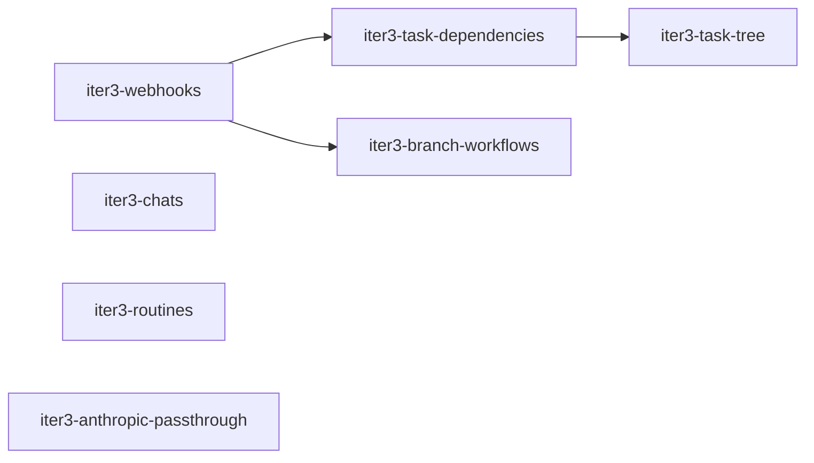

# Iteration 3 — Team Workflow

> **Draft (2026-10-23), not agreed yet.** Scope and plan for the third iteration ([`roadmap.md`](roadmap.md)). Architecture and decisions: [`product/context.md`](../context.md); runs and workspaces: [`design/agent-run.md`](../../design/agent-run.md); agent patterns: [`product/agent-playbook.md`](../agent-playbook.md). OpenSpec changes are created when the iteration starts.

## 1. Goal

Let agents work as a team on a project, with forge events driving the work instead of humans relaying them:

- Forge events (submitted reviews, CI results, merged PRs, mentions) reach the right task without a human (ADR-0015).
- Tasks depend on other tasks: on their completion or on their PR being merged (ADR-0026, ADR-0033).
- Tasks form a tree. Subtasks can branch off their parent's branch, and a reviewing task can be based on the branch it reviews (ADR-0034, ADR-0041).
- Agents rebase task branches with lease and work on existing branches (ADR-0025, ADR-0033).
- A long-lived chat with a persona per project creates and coordinates this work; a project context document is injected into every run (ADR-0026).
- Routines start tasks on a schedule.
- The Anthropic subscription token leaves the sandbox (ADR-0010 accepted risk).

Prerequisites: iteration 2 is done ([`iteration-2.md`](iteration-2.md)).

## 2. Demo scenario (definition of done)

1. In the CEO chat of a project, the board member asks for a change. The CEO creates `DF-20` (implementation, agent A) and `DF-21` (review, agent B) with `blocked_by: DF-20` and `base_task: DF-20` (pattern 2.2).
2. A commits and calls `complete_task`. `DF-21` starts automatically; its HEAD contains A's changes. B builds, runs the tests and submits a review with line comments in the forge.
3. The submitted review wakes `DF-20` through the webhook (individual review comments don't). A addresses the comments and completes again. `DF-21` runs again and sees the new commits without fetching anything. B approves and completes; the PR of `DF-20` is marked ready.
4. A feature task `DF-30` with `subtask_base: parent-branch` and `subtask_merge: parent-agent` gets two iteration subtasks, the second blocked by "PR merged" of the first. The feature agent merges the first subtask PR into the feature branch; the second subtask starts and finds the merge on its base.
5. A routine creates a nightly task. A CI failure on its PR wakes it.
6. The sandboxes of all runs hold no Anthropic token.

Automated with the fake ACP agent and a fake forge webhook sender (`iter1-demo-e2e` is extended). Steps 1–3 are also run once manually with Claude Code against Forgejo.

## 3. Changes

| Change | Scope |
|---|---|
| `iter3-webhooks` | ADR-0015: webhook endpoint in the control plane, `handle-webhook` in the Forgejo plugin with host-side signature verification, filtering (own bot, submitted reviews only), debouncing per task, routing by branch → task mapping and issue mentions, queued notification messages. |
| `iter3-task-dependencies` | ADR-0026, ADR-0033: `blocked_by` relations on task completion and on "PR merged"; dependent tasks start automatically; a PR closed without merge queues a message instead of unblocking. Generalizes the "child completes → wake parent" trigger (ADR-0016). |
| `iter3-task-tree` | ADR-0034, ADR-0041: `parent_id`, group tasks, `subtask_base` / `subtask_merge` resolution, `base_task`, draft PRs against the base branch, prepare fast-forward for task branches without own commits, notices on parent-branch changes, factory tools to create subtasks and merge subtask PRs, questions to the parent task's agent (iteration-2 decision 8), limits on depth and children. UI: Overview and Sub-tasks tabs in the details column, done/total chip on task rows (see [`roadmap.md`](roadmap.md)). |
| `iter3-branch-workflows` | ADR-0033, ADR-0025: branch rewrite policy per project (`never` / `with-lease` / `always`) in the runtime and the Git proxy, tasks starting from existing branches, PR modes `none` and `attach`, forge capabilities to list open PRs and read CI status and job logs. |
| `iter3-chats` | ADR-0026: one chat per (persona, project) with summary-based compaction, project context document injected into every run, `project:context:write`. |
| `iter3-routines` | Scheduled tasks with a fixed prompt and persona (`croner`, ADR-0003). |
| `iter3-anthropic-passthrough` | Anthropic pass-through in the gateway: pod-IP identity, bearer swap, streaming, like the Git proxy. Depends on the `ANTHROPIC_BASE_URL` result of the iteration-1 Claude spike. |

Suggested order: `iter3-webhooks` first, since review routing and "PR merged" dependencies need it. Then `iter3-task-dependencies`, then `iter3-task-tree`: pattern 2.2 only runs on its own once both exist. `iter3-branch-workflows` follows `iter3-webhooks` (CI status, merge triggers). `iter3-chats`, `iter3-routines` and `iter3-anthropic-passthrough` are independent and can run in parallel.

## 4. Decisions taken for this iteration

| # | Decision | Alternatives |
|---|---|---|
| 1 | ADR-0041 (`base_task`, prepare fast-forward) is part of `iter3-task-tree`, not a change of its own: both decide `Workspace.base_branch` at creation and change the PR target. | Separate change: two changes editing the same specs (`workspace-lifecycle`, `pull-request-lifecycle`). |
| 2 | "PR merged" dependencies are part of `iter3-task-dependencies`, not `iter3-branch-workflows`. | Bundle with branch rewrites (ADR-0033): splits the dependency model across two changes. |

To decide before the iteration starts: debounce window (ADR-0015 says 30–60 s), default limits on tree depth and children, whether a dependent task restarts on every re-completion of its dependency or only once per new commit.

## 5. Contract changes (all additive, expected)

| Contract | Change |
|---|---|
| `darkfactory.agent.v1` | Branch rewrite policy in `Assign` for pushes with lease (ADR-0033). Base branches need no change; they reach the runtime as `Workspace.base_branch` (ADR-0034, ADR-0041). |
| `darkfactory.gateway.v1` | Branch rewrite policy in `GitRoute`; Anthropic route and credential per sandbox. |
| Integrations WIT | `handle-webhook`, `pull-requests.merge`, branch creation, list open PRs with filters, CI status and job logs (ADR-0028, ADR-0033). |
| Factory tools | Creating tasks with `blocked_by` and `base_task`, creating subtasks, merging subtask PRs, updating the project context. |

## 6. Out of scope (later iterations)

- Plugin-based context compaction for chats (F3).
- Cost budgets per subtree (ADR-0034).
- Agents deciding approvals (iteration 5).
- A read-only task mode that rejects a reviewer's pushes (ADR-0041); added only if reviewers commit in practice.
- Heartbeats (ADR-0016).

## 7. Verify first (spikes)

- Forgejo webhooks: which events distinguish a submitted review from individual review comments; signature header and payload shape (`product/context.md`, open questions).
- Forgejo API: merging a PR with the project's merge method, creating a branch from a ref, the draft/WIP mechanism (ADR-0025).
- Claude Code with `ANTHROPIC_BASE_URL` pointing at the gateway: streaming, token usage reporting.
