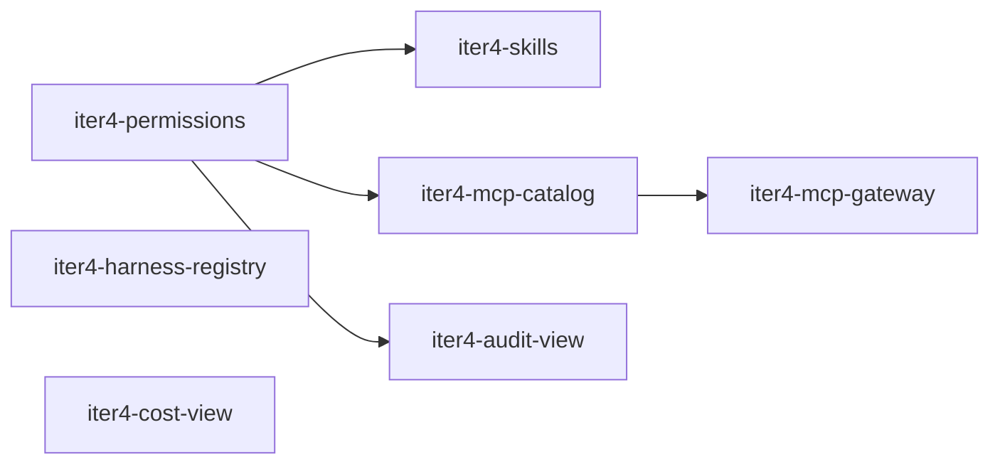

# Iteration 4 — Harnesses, Tools and Skills

> **Draft (2026-10-30), not agreed yet.** Scope and open questions for the fourth iteration ([`roadmap.md`](roadmap.md)). Architecture and decisions: [`product/context.md`](../context.md) (F12, F13); egress and gateway: [`design/egress.md`](../../design/egress.md); runs: [`design/agent-run.md`](../../design/agent-run.md). Contracts are sketched only; OpenSpec changes are created when the iteration starts.

## 1. Goal

Agents use the harnesses, third-party tools and skills configured in the factory, still without credentials in the sandbox, and humans see what agents did and what it cost:

- Operators register harness images; personas use any registered harness, or "Generic ACP" with an adapter command from the project image (F12).
- Third-party MCP servers (e.g. Context7, forgejo-mcp) are registered once with their credentials; agents reach a curated tool set through the gateway (ADR-0032).
- Skills are managed in the factory and delivered to every run (F13).
- Roles beyond `board-member`, and instance operations agents may perform with deny, approval or allow (ADR-0011).
- An audit log view and cost views (ADR-0021).

Prerequisites: iteration 3 is done, in particular `iter3-inference-gateway` ([`iteration-3.md`](iteration-3.md)): API-key harnesses need it, otherwise their keys enter the sandbox (ADR-0010).

## 2. Demo scenario (definition of done)

1. An operator registers the harness image of an ACP registry agent with an `openai-compatible` provider. A persona selects it; a task completes. The sandbox holds no API key; the gateway reports the usage.
2. A project whose image contains an ACP adapter uses "Generic ACP" with its adapter command; a task completes.
3. An admin registers Context7 with its API key. The control plane discovers the tools; the admin enables a subset and grants it to a persona. The agent calls a tool; the sandbox holds no key; the gateway records the call. A tool added upstream shows up disabled and flagged.
4. An agent requests a tool it wasn't granted (`tool-access`). The board member approves; the next call works without restarting the run.
5. An admin creates a skill and assigns it to a persona; the run's harness lists it next to the built-in `dark-factory-basics`. The CEO agent asks to add a skill to another persona (`instance-operation`, mode "requires approval"); after approval the change applies.
6. A user with the `controller` role sees everything read-only. The audit log view shows the agent-created tasks, push records, decided requests and the skill change; the cost view shows the "what if" cost per run, task, persona and project, and the actual cost of API-billed runs.

Automated with the fake ACP agent and a fake MCP server; step 1 and step 3 also run once manually against a real agent and Context7.

## 3. Changes

| Change | Scope |
|---|---|
| `iter4-permissions` | ADR-0011: `admin` and `controller` roles, one `can(principal, action, resource)` check, role → permission mapping in the instance configuration, instance-management permissions for agents (deny / requires approval / allow) with a ceiling, `instance-operation` approval type, `harness-permission` approvals for selected `session/request_permission` categories. |
| `iter4-harness-registry` | F12: harness registry instead of the fixed `claude-code` value, ACP registry presets, credential mapping to an inference provider or a Secret, default egress hosts per harness, "Generic ACP" with an adapter command; usage from the gateway (decision 13). |
| `iter4-mcp-catalog` | ADR-0032, control plane: register upstream servers (URL, credential reference), tool discovery (on registration, on demand, periodically), catalog snapshots, instance filters (selection, globs, read-only only), new and changed tools flagged, grants per persona and restrictions per project, `tool-access` approval type, UI. Project-scoped stdio servers from `.mcp.json`: the `repository-mcp-server` approval activates an entry, the runtime starts it in the sandbox and passes it in `session/new` (decision 8). |
| `iter4-mcp-gateway` | ADR-0032, [`design/egress.md`](../../design/egress.md) §10: MCP endpoint (Streamable HTTP) in the gateway, pod-IP identity, credential injection, tool set enforcement on `tools/list` and `tools/call`, `search_tools` / `load_server` for large sets, one call record per call; the runtime registers the endpoint in `session/new`. |
| `iter4-skills` | F13: skill storage with versions, built-in skills from [`agent-playbook.md`](../agent-playbook.md), assignment per persona and project, delivery in `Assign`, the runtime writes them into the harness's skill directory on every run, a transcript warning for shadowed repository skills (decision 12), UI, skill changes as an agent instance operation. |
| `iter4-audit-view` | Filterable `audit_log` list (actor, action, resource, time), push records and decided requests linked from their entries, desktop only (ADR-0035). |
| `iter4-cost-view` | ADR-0021: pricing tables in the instance configuration, versioned by date, seeded with defaults (decision 14); cost per run, task, persona and project from harness and gateway usage; "what if" for subscription runs, actual cost for API-billed runs. |

Suggested order: `iter4-permissions` first, because registering harnesses, MCP credentials and skills needs the `admin` role, and agent instance operations need the modes. `iter4-mcp-catalog` before `iter4-mcp-gateway` (the gateway only receives the result). `iter4-harness-registry` and `iter4-cost-view` are independent and can run in parallel.

## 4. Decisions

Taken (from existing ADRs and future options):

| # | Decision | Source |
|---|---|---|
| 1 | Third-party MCP servers are reached only through one aggregating gateway endpoint, which the runtime passes in `session/new`; harnesses never connect to upstream servers directly. | ADR-0032 |
| 2 | Tools added upstream are disabled by default; a run's tool set is enabled catalog ∩ persona grants ∩ project restrictions. | ADR-0032 |
| 3 | Model credentials reach harnesses only through the inference endpoint; a harness that can't use a base URL is not supported without an explicit accepted-risk decision. | F12, ADR-0010 |
| 4 | ACP has no skill concept: skills are files the runtime writes into the harness's skill directory on every run. | F13 |
| 5 | Roles come from the token's `roles` claim, never from the database. | ADR-0011 |
| 6 | Audit and cost views are desktop-only. | ADR-0035 |

Decided on 2026-10-30 for this iteration:

| # | Decision | Alternatives |
|---|---|---|
| 7 | Upstream MCP servers use static credentials (header, bearer token). OAuth-based servers go to the backlog. | OAuth flows in the control plane: token storage and refresh per server before a single server needs it. |
| 8 | The gateway serves HTTP MCP servers only. A stdio server either runs behind a stdio → HTTP bridge and is registered as an HTTP upstream, if it needs no project context; or it runs in the sandbox as a project-scoped server from `.mcp.json`, activated by a `repository-mcp-server` approval and started by the runtime, without credentials from the factory. | Stdio servers in the gateway: untrusted code next to all upstream credentials, and servers that need the workspace have none there. |
| 9 | Harnesses are registered in the instance configuration through the Helm chart, like plugins (`iter2-plugin-distribution`). | UI registration: images are infrastructure and need image volumes in the pod spec. |
| 10 | ACP registry presets are a vendored list, updated by an `xtask`; no registry fetch at runtime. | Fetching the registry at runtime: a network dependency of the control plane for static data. |
| 11 | Skills are database rows (ADR-0020) with versions and a size limit for supporting files. | OCI artifacts or a Git repository per skill: a second store. |
| 12 | Factory skills win over repository skills with the same name; the run's transcript shows a warning naming the shadowed repository skill. | Repository skills win: the repository could replace a built-in skill such as `dark-factory-basics`. |
| 13 | Usage comes from one place, the gateway's inference endpoint. Harness-reported usage (ACP, Claude's session log) is a fallback only while a harness doesn't use the endpoint; no new per-harness parsers. | Usage per harness: one parser per harness and no comparable numbers. |
| 14 | Pricing tables are part of the instance configuration, versioned by date (ADR-0021), seeded with defaults. A scheduled import of published price lists (as AgentGateway does) is in the backlog. | Import first: an external dependency before the cost view exists. |

## 5. Contract changes (expected)

| Contract | Change |
|---|---|
| `darkfactory.agent.v1` | `Assign.harness` generalized (harness id, adapter command, environment mapping); `Assign.skills` (name, version, files, hash); the gateway MCP endpoint in `Assign`. |
| `darkfactory.gateway.v1` | MCP route per sandbox (tool set per upstream server), upstream credentials in the snapshot, call records. |
| Factory tools | `request_approval` with `tool-access` and `instance-operation`; instance-operation tools for agents (e.g. assign a skill), gated by the permission modes. |
| Database | `personas.harness` references the registry instead of the `claude-code` check; `mcp_servers`, tool catalog snapshots, grants and restrictions; skills with versions and assignments; MCP call records. |

## 6. Out of scope (later iterations)

- Repository configuration, lifecycle hooks, sidecars, build and test secrets, persona and CIDR egress (iteration 5).
- Agents deciding approvals (iteration 6).
- MCP tools as WASI components (F2), MCP resources and prompts in the UI.
- OAuth-based MCP servers, scheduled import of published price lists (backlog).
- Token and cost budgets enforced by the gateway, subscription pools (F6) (backlog).
- Org chart and delegation allowlists (ADR-0043, backlog).

## 7. Verify first (spikes)

- ACP `session/new` with an HTTP MCP server: support in the Claude adapter (`mcpCapabilities.http`) and in `df-native`, custom headers.
- Claude Code reads skills from the skill directory under `HOME` (`/data/home`) when started through the ACP adapter.
- ACP registry: format, and which registered agents accept a base URL for model access (compatible with the inference endpoint).
- `rmcp` Streamable HTTP server and client in the gateway: per-run sessions, `search_tools` / `load_server`.
- Whether all registry presets can send their model traffic through the inference endpoint (decision 13), and what usage ACP adapters report for those that can't.
- The runtime starting a stdio MCP server from `.mcp.json` in the sandbox and passing it in `session/new`.
- Context7 authentication (header name, key format) as the first static-credential server.
