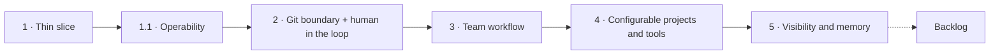

# Roadmap — Iterations

> Grouping of the planned features into iterations, agreed on 2026-10-21. Each iteration is broken into OpenSpec changes when it starts. Architecture and decisions: [`product/context.md`](../context.md); first iteration: [`iteration-1.md`](iteration-1.md).

## Overview

| Iteration | Theme | Main references |
|---|---|---|
| 1 | Thin vertical slice | [`iteration-1.md`](iteration-1.md) |
| 1.1 | Operability | `openspec/changes/agent-session-logging`, `openspec/changes/otel-metrics-and-tracing`, [`docs/tech_debt.md`](../../docs/tech_debt.md) |
| 2 | Closed Git boundary + human in the loop | [`iteration-2.md`](iteration-2.md), F1, ADR-0038 |
| 3 | Team workflow | ADR-0026, ADR-0034, ADR-0033, ADR-0015, ADR-0016 |
| 4 | Configurable projects and tools | F9, F10, F11, ADR-0011, ADR-0032, ADR-0039 |
| 5 | Visibility and memory | F8, ADR-0021, ADR-0040 |

## 1 — Thin vertical slice

Remaining OpenSpec changes: `iter1-control-plane-web`, `iter1-egress-gateway`, `iter1-integration-plugins`, `iter1-sandbox-provisioning`, `iter1-demo-e2e`. Scope and definition of done: [`iteration-1.md`](iteration-1.md).

## 1.1 — Operability

- Session logging, log format and per-component levels (`agent-session-logging`).
- OpenTelemetry metrics and optional tracing (`otel-metrics-and-tracing`).
- Medium tech debt: TD-1 (git timeouts), TD-8 (teardown in the scheduler loop), TD-17 (tool-call timeouts and drain budgets). TD-2 (shutdown flush window) and TD-18 (interrupted provisioning) moved to `iter2-run-resilience`.

## 2 — Closed Git boundary + human in the loop

- **Git smart-HTTP proxy in the gateway (F1, [`design/agent-run.md`](../../design/agent-run.md) §11):** credential injection (removes the credential helper and the forge egress rule from sandboxes), ref enforcement (task branch and `factory/wip/<key>` only), secret scanning of every pushed pack, built-in push checks (commit identity, protected paths incl. `.dark-factory/**`, size/file-type limits, linear history), push audit log, cached bare mirror per repository.
- **Questions and approval requests (ADR-0038):** `ask_question` and `request_approval` factory tools, `AwaitingInput`, pending-requests inbox (phone and desktop), audit entries. Initial approval types: `push-check-exception` and `network-access`.
- **Egress from approvals ([`design/egress.md`](../../design/egress.md) §8):** task-scoped allowlist entries; allow a denied host from the live log; denied hosts raise a `network-access` request automatically.
- **Cancel button** for tasks and runs.
- **Unattended runs (`iter2-run-resilience`):** rate-limited tasks resume at the retry time, bounded automatic resume after lost sandboxes and provisioning failures, concurrency limit per instance, final report flush across control plane restarts (TD-2, TD-18).
- **Task volume lifecycle (`iter2-task-volume-lifecycle`, [`design/agent-run.md`](../../design/agent-run.md) §5.5):** retention for closed and idle tasks, "reset workspace".
- **Plugin distribution (`iter2-plugin-distribution`, ADR-0018):** plugins as OCI images mounted into the control plane via image volumes; the control plane image no longer bundles plugins.
- **Gateway readiness and Git retries:** gateway pods are ready only after the first policy snapshot; the runtime retries transient Git failures (folded into `iter1-egress-gateway` and `iter2-git-proxy`).

Dependency: approval-gated push checks need the `push-check-exception` approval, so both ship together.

## 3 — Team workflow

- **Chats per (persona, project), `blocked_by` dependencies, project context document (ADR-0026).** Chats start with a simple summary-based compaction; plugin-based compaction (F3) stays in the backlog.
- **Task tree, subtask branches and merging (ADR-0034)**, incl. `pull-requests.merge` and branch creation in the integrations package.
- **Branch rewrites, fan-out and merge triggers (ADR-0033).**
- **Inbound events (ADR-0015):** webhook endpoint, `handle-webhook` in the Forgejo plugin, filtering, debouncing and routing of CI, review and issue-mention events.
- **Routines:** scheduled tasks with a fixed prompt and a fixed persona.
- **Tasks starting from existing branches** and PR modes other than "create draft PR" (ADR-0025).
- **Anthropic pass-through in the gateway:** removes the subscription token from sandboxes (ADR-0010 accepted risk). Same shape as the Git proxy: pod-IP identity, bearer swap, streaming. Depends on the `ANTHROPIC_BASE_URL` result of the iteration-1 Claude spike.

Dependency: "PR merged" dependencies and review routing need the webhooks of ADR-0015.

## 4 — Configurable projects and tools

- **Repository configuration file (F11, ADR-0039)** with the `project-config` approval. Needs the proxy's protection of `.dark-factory/**` (iteration 2).
- **Workspace lifecycle hooks (F9)** and **sidecar services (F10).**
- **Third-party MCP servers through the gateway (ADR-0032)** with tool catalogs and the `tool-access` / `repository-mcp-server` approvals.
- **Skill management** (built-in and project skills, [`agent-playbook.md`](../agent-playbook.md)).
- **Full permission model (ADR-0011):** admin and controller roles, instance-management operations for agents, `instance-operation` and `harness-permission` approvals.
- **Egress:** persona allowlist scope, CIDR targets (task scope moved to iteration 2).

## 5 — Visibility and memory

- Audit log view, cost and "what if" views (ADR-0021), dashboard-wide live status.
- Full-text search across tasks and transcripts.
- Artifacts per task.
- **Workspace changes view (F8)**, reading from the Git proxy's mirror.
- **Agent memory (ADR-0040)**, explicit memories with full-text search first.
- Installable web app with push notifications (ADR-0035).

## Backlog (unscheduled)

| Item | Reference |
|---|---|
| Full-harness mode and inference gateway | context §4.1, F5, [`design/egress.md`](../../design/egress.md) §9 |
| Subscription pools and fallback | F6 |
| Further ACP harnesses, harness delivery via a second image volume | context §7 |
| MCP tools as WASI components | F2 |
| Context compaction plugins | F3 |
| `push-check` WASI plugins | [`design/agent-run.md`](../../design/agent-run.md) §11 |
| Declarative configuration import | F4 |
| Commit signing without keys in the sandbox | F7 |
| Cilium mode, DNS server in the gateway | [`design/egress.md`](../../design/egress.md) §5.3, §12 |
| Separate UIDs for runtime and harness | [`design/agent-run.md`](../../design/agent-run.md) §17 |
| LSP support | context §4.2 |
| Cloud VM sandboxes (idea, conflicts with current non-goals) | [`design/cloud-vm-sandboxes.md`](../../design/cloud-vm-sandboxes.md) |
| Remaining low-severity tech debt | [`docs/tech_debt.md`](../../docs/tech_debt.md) |
