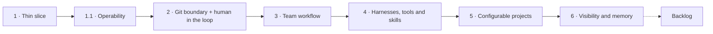

# Roadmap — Iterations

> Grouping of the planned features into iterations, agreed on 2026-10-21, iteration 4 split on 2026-10-30. Each iteration is broken into OpenSpec changes when it starts. Architecture and decisions: [`product/context.md`](../context.md); first iteration: [`iteration-1.md`](iteration-1.md).
>
> This file is the single list of work that is thought of but not implemented: an item is either in an iteration or in the [backlog](#backlog-unscheduled). A non-goal of an OpenSpec change or ADR that is a real follow-up gets an entry here; otherwise its source says "rejected".

## Overview

| Iteration | Theme | Main references |
|---|---|---|
| 1 | Thin vertical slice | [`iteration-1.md`](iteration-1.md) |
| 1.1 | Operability | `openspec/changes/agent-session-logging`, `openspec/changes/otel-metrics-and-tracing`, [`docs/tech_debt.md`](../../docs/tech_debt.md) |
| 2 | Closed Git boundary + human in the loop | [`iteration-2.md`](iteration-2.md), F1, ADR-0038 |
| 3 | Team workflow | [`iteration-3.md`](iteration-3.md) (draft), ADR-0043, ADR-0044, ADR-0026, ADR-0034, ADR-0041, ADR-0033, ADR-0015, ADR-0016 |
| 4 | Harnesses, tools and skills | [`iteration-4.md`](iteration-4.md) (draft), F12, F13, ADR-0011, ADR-0021, ADR-0032 |
| 5 | Configurable projects | F9, F10, F11, ADR-0010, ADR-0039 |
| 6 | Visibility and memory | F8, ADR-0035, ADR-0038, ADR-0040 |

## 1 — Thin vertical slice

Remaining OpenSpec changes: `iter1-control-plane-web`, `iter1-egress-gateway`, `iter1-integration-plugins`, `iter1-sandbox-provisioning`, `iter1-demo-e2e`, `transcript-view-polish`, `iter1-keep-alive-and-review`, `egress-log-viewport`, `hide-system-prompt-blocks`. Scope and definition of done: [`iteration-1.md`](iteration-1.md).

## 1.1 — Operability

- Session logging, log format and per-component levels (`agent-session-logging`).
- OpenTelemetry metrics and optional tracing (`otel-metrics-and-tracing`).
- Medium tech debt: TD-1 (git timeouts), TD-8 (teardown in the scheduler loop), TD-17 (tool-call timeouts and drain budgets). TD-2 (shutdown flush window) and TD-18 (interrupted provisioning) moved to `iter2-run-resilience`.

## 2 — Closed Git boundary + human in the loop

- **Git smart-HTTP proxy in the gateway (F1, [`design/agent-run.md`](../../design/agent-run.md) §11):** credential injection (removes the credential helper and the forge egress rule from sandboxes), ref enforcement (task branch and `factory/wip/<key>` only), secret scanning of every pushed pack, built-in push checks (commit identity, protected paths incl. `.dark-factory/**`, size/file-type limits, linear history), push audit log, cached bare mirror per repository.
- **Questions and approval requests (ADR-0038):** `ask_question` and `request_approval` factory tools, `AwaitingInput`, pending-requests inbox (phone and desktop), audit entries. Initial approval types: `push-check-exception` and `network-access`.
- **Egress rule editing (`egress-rule-editing`):** edit an existing rule (host, port, scope) from the egress rules page instead of delete and add; update route, validation, audit action and policy announcement.
- **Egress from approvals ([`design/egress.md`](../../design/egress.md) §8):** task-scoped allowlist entries; allow a denied host from the live log; denied hosts raise a `network-access` request automatically.
- **Cancel button** for tasks and runs.
- **Unattended runs (`iter2-run-resilience`):** rate-limited tasks resume at the retry time, bounded automatic resume after lost sandboxes and provisioning failures, concurrency limit per instance, final report flush across control plane restarts (TD-2, TD-18).
- **Task volume lifecycle (`iter2-task-volume-lifecycle`, [`design/agent-run.md`](../../design/agent-run.md) §5.5):** retention for closed and idle tasks, "reset workspace".
- **Plugin distribution (`iter2-plugin-distribution`, ADR-0018):** plugins as OCI images mounted into the control plane via image volumes; the control plane image no longer bundles plugins.
- **Several forges side by side (`iter2-multi-forge`):** each project goes to the forge plugin that claims the host of its repository URL (no plugin per project); per-plugin API URL and `Authorization` scheme; a broken plugin no longer stops the control plane; the UI shows the forge per project.
- **GitHub plugin (`iter2-github-plugin`):** pull requests and issues on github.com and GitHub Enterprise Server, draft pull requests through a title prefix (default, works in private repositories on GitHub Free), GitHub's native drafts, or native drafts with the title prefix as fallback; enabled for `github.com` in the default release.
- **Gateway readiness and Git retries:** gateway pods are ready only after the first policy snapshot; the runtime retries transient Git failures (folded into `iter1-egress-gateway` and `iter2-git-proxy`).

Dependency: approval-gated push checks need the `push-check-exception` approval, so both ship together.

## 3 — Team workflow

- **Agent-created tasks and delegation (ADR-0043, ADR-0026):** the creator of a task becomes a principal (human or task), agents create tasks for other personas (`create_task`, `list_personas`, personas get a description), `blocked_by` dependencies, a parent wakes on every child that ends. The task's parent is also the escalation target.
- **Task artifacts (`iter3-artifacts`, ADR-0044):** Markdown artifacts per task, chats included; `write_artifact` (own task), `list_artifacts` and `read_artifact` (own, ancestors, descendants, `blocked_by`, `base_task`); research results travel between tasks without a commit. A plain rendered view in the task page and chat UI.
- **Chats as tasks (ADR-0043, ADR-0026):** a chat is a task of kind `chat` per (persona, project), the root of the delegation chain, with a read-only checkout of the default branch, a `-CHAT` key suffix, its own chat UI (not in the task list) and the project context document. Chats start with a simple summary-based compaction; plugin-based compaction (F3) stays in the backlog.
- **Tasks based on another task's branch (ADR-0041):** `base_task` at task creation, prepare fast-forwards task branches without own commits to their base.
- **Task tree, subtask branches and merging (ADR-0034, no group tasks)**, questions to the parent task's agent (`ask_question` addressed to the parent, `answer_question`; escalation along the parent chain, ADR-0043), incl. `pull-requests.merge` and branch creation in the integrations package. UI: the details column becomes tabs (Overview, Sub-tasks with a progress bar and the sub-tasks with their status), and task rows with sub-tasks get a done/total chip (design canvas, "Later" row).
- **Branch rewrites, fan-out and merge triggers (ADR-0033).**
- **Inbound events (ADR-0015):** webhook endpoint, `handle-webhook` in the forge plugins (Forgejo, GitHub), filtering, debouncing and routing of CI, review and issue-mention events.
- **Routines:** scheduled tasks with a fixed prompt and a fixed persona.
- **Monitors:** a task-scoped wake-up set by the agent (factory tool) or a human, for example to poll a third-party system without webhooks. A due monitor queues a system prompt (reason `monitor.wake`) through the same path as messages and routines. A wake-up due within `runs.keepAliveSeconds` extends the control plane's idle deadline (`iter1-keep-alive-and-review`), so the sandbox stays up; a later one lets the run end and starts a new run when due.
- **Tasks starting from existing branches** and PR modes other than "create draft PR" (ADR-0025).
- **Inference endpoint in the gateway (`iter3-inference-gateway`, F5, [`design/egress.md`](../../design/egress.md) §9):** provider kinds `anthropic` (subscription token or API key) and `openai-compatible`; removes model credentials from sandboxes (ADR-0010 accepted risk) and measures usage per request (ADR-0021). Same shape as the Git proxy: pod-IP identity, credential swap, streaming. Depends on the `ANTHROPIC_BASE_URL` result of the iteration-1 Claude spike.

Dependency: "PR merged" dependencies and review routing need the webhooks of ADR-0015.

## 4 — Harnesses, tools and skills

What agents can use, configured in the factory and delivered without credentials in the sandbox.

- **Harness registry and Generic ACP (F12):** operators register harness images (ACP registry agents as presets, adapter command, credential mapping, default egress hosts); users pick a registered harness without further setup, or "Generic ACP" with an adapter command from the project image. Model credentials only through the inference endpoint (iteration 3).
- **Third-party MCP servers through the gateway (ADR-0032)** with tool catalogs, credential injection and the `tool-access` / `repository-mcp-server` approvals. HTTP servers with static credentials only; stdio servers run behind a stdio → HTTP bridge or project-scoped in the sandbox from `.mcp.json` ([`iteration-4.md`](iteration-4.md), decision 8).
- **Skill management (F13):** built-in skills from [`agent-playbook.md`](../agent-playbook.md) (`dark-factory-basics`), instance skills, assignment per persona and project, delivery into the harness's skill directory on every run.
- **Full permission model (ADR-0011):** admin and controller roles, instance-management operations for agents (personas, skills, tool grants, routines, projects), `instance-operation` and `harness-permission` approvals.
- **Audit log view:** filterable list of `audit_log` entries including push records (`iter2-git-proxy`) and decided requests; desktop only (ADR-0035).
- **Cost and "what if" views (ADR-0021):** pricing tables in the instance configuration, versioned by date; cost per run, task, persona and project from harness and gateway usage.

Dependency: API-key harnesses need the inference endpoint of iteration 3, otherwise their keys would enter the sandbox (ADR-0010).

## 5 — Configurable projects

- **Repository configuration file (F11, ADR-0039)** with the `project-config` approval. Needs the proxy's protection of `.dark-factory/**` (iteration 2).
- **Workspace lifecycle hooks (F9)** and **sidecar services (F10).**
- **Build and test secrets** (private registries, test databases; ADR-0010 "out of scope for now"): injected by the gateway like Git, inference and MCP credentials, never stored in the sandbox. Needs an ADR.
- **Egress:** persona allowlist scope, CIDR targets (task scope moved to iteration 2).

## 6 — Visibility and memory

- Dashboard-wide live status.
- Full-text search across tasks and transcripts.
- Artifact cards in a details tab with a preview, title, time and type (design canvas, "Later" row); artifacts and their tools come with iteration 3 (ADR-0044).
- **Workspace changes view (F8)**, reading from the Git proxy's mirror.
- **Agent memory (ADR-0040)**, explicit memories with full-text search first (phases 1 and 2).
- Installable web app with push notifications (ADR-0035).
- **Agents deciding approvals** (e.g. a CEO persona), bounded by the no-escalation rule (ADR-0038, ADR-0011). Needs the permission model of iteration 4.

## Backlog (unscheduled)

Status: *idea* (direction only), *decided* (decision recorded, no design), *designed* (design written).

| Item | Status | Reference |
|---|---|---|
| Full-harness mode as a separate ACP binary (`df-native`); uses the inference endpoint of iteration 3 | decided | ADR-0045, context §4.1, `openspec/changes/full-harness-mode` |
| Factory minion: optional model call in the control plane for task titles and summaries (title source `generated`, see `ui-redesign`); no tools, single text output, sanitized; uses the provider configuration of the inference endpoint; ADR on model credentials in the control plane | decided | `openspec/changes/archive/2026-10-23-ui-redesign/design.md` (D7), [`design/egress.md`](../../design/egress.md) §9 |
| OAuth-based upstream MCP servers (token storage and refresh per server) | idea | [`iteration-4.md`](iteration-4.md) decision 7 |
| Scheduled import of published model price lists into the pricing tables (as AgentGateway does) | idea | [`iteration-4.md`](iteration-4.md) decision 14, ADR-0021 |
| Token and cost budgets: per persona, per task subtree, enforced per request by the gateway | idea | ADR-0011, ADR-0034, [`design/egress.md`](../../design/egress.md) §9 |
| Subscription pools and fallback | idea | F6 |
| MCP tools as WASI components | idea | F2 |
| Context compaction plugins (model-generated summaries, mid-run compaction) | idea | F3, `openspec/changes/iter2-continuation-summary` |
| `push-check` WASI plugins, Git LFS through the proxy, file-type limits | idea | F1, [`design/agent-run.md`](../../design/agent-run.md) §11, `openspec/changes/iter2-git-proxy` |
| Declarative configuration import | idea | F4 |
| Configuration view: read-only page listing the effective instance options (`InstanceConfig`, secrets redacted), the first option being `web.showHiddenBlocks` | decided | `openspec/changes/archive/2026-10-28-hide-system-prompt-blocks` |
| Commit signing without keys in the sandbox, signature verification in the Git proxy | designed | F7, [`design/agent-run.md`](../../design/agent-run.md) §12 |
| Cilium mode, DNS server in the gateway | designed | [`design/egress.md`](../../design/egress.md) §5.3, §12 |
| Persisted per-run egress aggregates (host, verdict, connections, bytes) | designed | [`design/egress.md`](../../design/egress.md) §8, §13 |
| `dark-factory egress tail` CLI | idea | [`design/egress.md`](../../design/egress.md) §8 |
| Org chart between personas (`reports_to`, delegation allowlists, who may hire whom), per-project persona rosters | idea | ADR-0043 |
| Read-only task mode that rejects a reviewer's pushes, only if reviewers commit in practice | idea | ADR-0041 |
| Heartbeats (periodic wake-ups), only if events, routines and monitors turn out to be insufficient | idea | ADR-0016 |
| Agent memory phases 3 and 4: curator routine, embedding or model-based selection, entity memory | decided | ADR-0040 |
| SSH repository URLs, issue-only trackers | idea | `openspec/changes/archive/2026-10-30-iter2-multi-forge` |
| GitHub App authentication for the GitHub plugin: installation tokens minted and cached by the host (JWT signed with the app key); needs an ADR | idea | `openspec/changes/iter2-github-plugin` |
| Shared crate for forge plugins (HTTP transport, draft prefixes), once a third forge plugin exists | idea | `openspec/changes/iter2-github-plugin` (D4) |
| Transcript archival of finished runs to the blob store (zstd JSONL) | idea | ADR-0012 |
| WASI 0.3 guests for plugins | idea | ADR-0002 |
| Separate UIDs for runtime and harness | idea | [`design/agent-run.md`](../../design/agent-run.md) §17 |
| LSP support | idea | context §4.2 |
| Cloud VM sandboxes (conflicts with current non-goals) | idea | [`design/cloud-vm-sandboxes.md`](../../design/cloud-vm-sandboxes.md) |
| Valkey session store for the web UI as an alternative to PostgreSQL (performance: no database round trip per request); needs its own per-session lock for token refresh | idea | `crates/df-web/src/auth/store.rs` |
| Credential form autocomplete: Secret name from the Secrets in the factory namespace, key from the chosen Secret's keys; free text stays allowed with a soft "not found" hint, plain inputs when listing fails. The control plane gets `list`/`get` on Secrets in its namespace (values readable is accepted for a developer tool; no separate secrets namespace); only key names reach the UI | decided | design canvas, "Later" row |
| Phone layout of the network traffic page: at 390 px the page scrolls horizontally, because the Connections graph keeps its 398 px minimum width and the panels stay side by side instead of stacking | idea | `openspec/changes/archive/2026-10-30-ui-design-alignment/review-log.md` (browser check) |
| Remaining low-severity tech debt | — | [`docs/tech_debt.md`](../../docs/tech_debt.md) |
